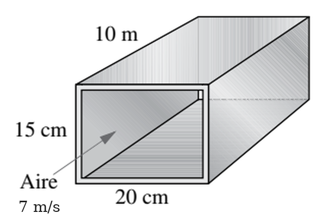
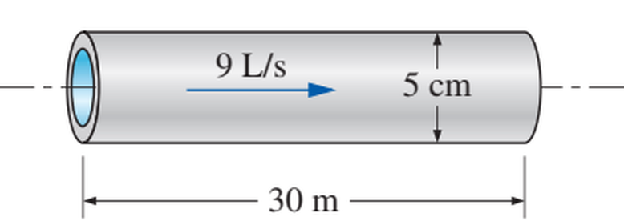
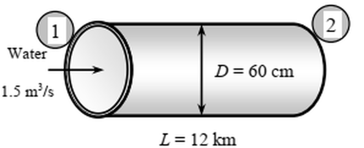
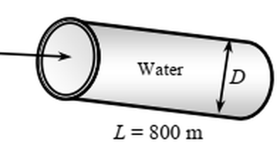
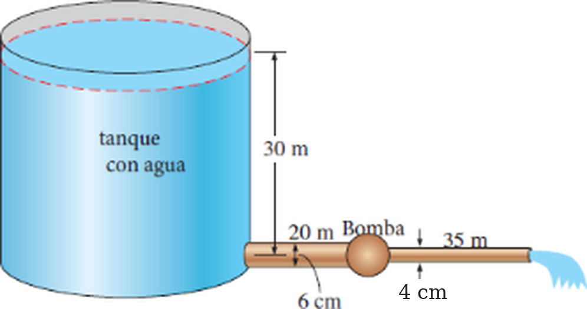

# Problemas de turbulencia (1)

**Sistemas de fluidos** · Flujo en tuberías (Colebrook, pérdidas de carga, potencia de bombeo) y transición en la capa límite de una placa plana.

El script [`problemas_turbulencia_1.py`](problemas_turbulencia_1.py) contiene los datos de cada problema y las funciones auxiliares (Colebrook, Haaland). Completa las partes marcadas con `TODO`.

**Método recomendado:** suposiciones → propiedades → velocidad y número de Reynolds (¿qué régimen?) → factor de fricción → pérdida de carga → ecuación de la energía si hay cotas, bombas o accesorios → comprobación de las hipótesis.

---

## Problema 1. Ducto rectangular de acero comercial

Aire a 1 atm y 35 °C entra en una sección de 10 m de largo de un ducto rectangular de 15 cm × 20 cm de sección transversal, de acero comercial, con una velocidad media de 7 m/s. Sin considerar los efectos de entrada, determine la potencia de ventilador necesaria para superar las pérdidas de presión en esta sección del ducto.

*Datos:* aire a 35 °C: ρ = 1.145 kg/m³, μ = 1.895 × 10⁻⁵ kg/(m·s). Acero comercial: ε = 0.045 mm.

**Respuesta:** 7 W

 

## Problema 2. Flujo laminar en un tubo capilar

Fluye agua a 10 °C (ρ = 999.7 kg/m³, μ = 1.307 × 10⁻³ kg/(m·s)) de forma estacionaria por una tubería de 0.12 cm de diámetro y 15 m de largo, con una velocidad media de 0.9 m/s. Determine: a) la caída de presión, b) la pérdida de carga y c) la potencia de bombeo necesaria para superar esta caída de presión.

**Respuestas:** a) 392 kPa, b) 40.0 m, c) 0.399 W

## Problema 3. Tubería horizontal de acero inoxidable

Fluye agua a 15 °C (ρ = 999.1 kg/m³, μ = 1.138 × 10⁻³ kg/(m·s)) a razón de 9 L/s, de forma estacionaria, por una tubería horizontal de acero inoxidable (ε = 0.002 mm) de 30 m de largo y 5 cm de diámetro. Determine: a) la caída de presión, b) la pérdida de carga y c) la potencia de bombeo necesaria.

 

## Problema 4. Recubrimiento interior de tubos de concreto

El agua para un área residencial se transporta a razón de 1.5 m³/s por tubos de concreto de 70 cm de diámetro interior, rugosidad 3 mm y 1500 m de longitud total. Para reducir la potencia de bombeo se propone recubrir el interior con un recubrimiento a base de petróleo de rugosidad 0.04 mm, que reduce el diámetro interior a 66 cm. Hay preocupación de que el aumento de la velocidad media contrarreste el beneficio. Tomando ρ = 1000 kg/m³ y ν = 1 × 10⁻⁶ m²/s, determine el porcentaje de aumento o disminución de la potencia de bombeo debida a la fricción.

## Problema 5. Calefacción geotérmica de distrito

Un sistema geotérmico transporta agua a 110 °C desde un pozo hasta una ciudad, aproximadamente a la misma elevación, a lo largo de 12 km, a razón de 1.5 m³/s, por tuberías de acero inoxidable de 60 cm de diámetro. Las presiones en el pozo y en la llegada a la ciudad son iguales. Las pérdidas menores son despreciables.

a) Con un rendimiento bomba-motor del 80 %, determine el consumo de potencia eléctrica para el bombeo. ¿Recomendaría una sola bomba grande o varias más pequeñas distribuidas a lo largo de la tubería?
b) Determine el coste diario de la electricidad si cuesta 0.06 €/kWh.
c) Se estima que el agua se enfría 0.5 °C en el trayecto. ¿Puede compensarlo el calentamiento por fricción?

*Datos:* agua a 110 °C: ρ = 950.6 kg/m³, μ = 0.255 × 10⁻³ kg/(m·s), cp = 4.229 kJ/(kg·°C). Acero inoxidable: ε = 0.002 mm.

 

## Problema 6. Flujo por gravedad en un tubo de plástico

Se transporta agua por gravedad por un tubo de plástico (liso) de 12 cm de diámetro y 800 m de longitud, con una pendiente de 0.01 (una caída de 1 m por cada 100 m de tubo). Con ρ = 1000 kg/m³ y ν = 1 × 10⁻⁶ m²/s, determine el caudal. Si el tubo fuera horizontal, ¿qué potencia haría falta para mantener el mismo caudal?

 

## Problema 7. Dos tuberías en serie con bomba

Se descarga agua a 15 °C (ρ = 999.1 kg/m³, μ = 1.138 × 10⁻³ kg/(m·s)) de un depósito a razón de 18 L/s mediante dos tuberías horizontales de hierro fundido (ε = 0.26 mm) conectadas en serie, con una bomba entre ellas. La primera tubería mide 20 m de largo y 6 cm de diámetro; la segunda, 35 m de largo y 4 cm de diámetro. El nivel del agua en el depósito está 30 m por encima del eje de la tubería. La entrada tiene bordes agudos (KL = 0.5) y las pérdidas en la conexión de la bomba son despreciables. Ignorando el factor de corrección de energía cinética, determine la carga de bombeo necesaria y la potencia de bombeo mínima.

 

## Problema 8. Efecto del diámetro de la segunda tubería

Reconsidere el problema 7. Con un programa (por ejemplo, el script de esta carpeta), estudie el efecto del diámetro de la segunda tubería sobre la carga de bombeo necesaria para mantener el caudal. Varíe el diámetro de 1 a 10 cm en incrementos de 1 cm. Tabule y represente los resultados. ¿Tienen sentido físico todos los valores?

## Problema 9. Transición en la capa límite de una placa plana

En un día caluroso (T = 30 °C) un camión circula por la carretera a 29.1 m/s. El lateral plano del camión se modela, en primera aproximación, como una capa límite de placa plana lisa. Estime la posición x a lo largo de la placa donde la capa límite comienza la transición a turbulencia. ¿A qué distancia desde el comienzo de la placa espera que la capa límite sea totalmente turbulenta? Dé ambas respuestas con una cifra significativa.

*Datos:* aire a 30 °C: ρ = 1.164 kg/m³, μ = 1.872 × 10⁻⁵ kg/(m·s). Placa muy lisa y flujo libre poco perturbado: la transición empieza en Rex ≈ 1 × 10⁵ y es totalmente turbulenta para Rex ≈ 3 × 10⁶.

## Problema 10. Transición en la capa límite de una placa plana

Aire a 30 °C fluye a una velocidad uniforme de 30.0 m/s a lo largo de una placa plana lisa. Calcule la posición x aproximada donde la capa límite comienza la transición hacia la turbulencia. ¿Aproximadamente en qué posición x es probable que la capa límite sea totalmente turbulenta?

**Respuestas:** 5 a 6 cm, 1 a 2 m.
